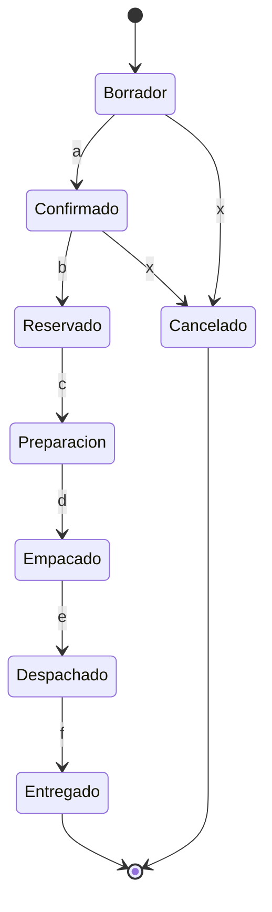
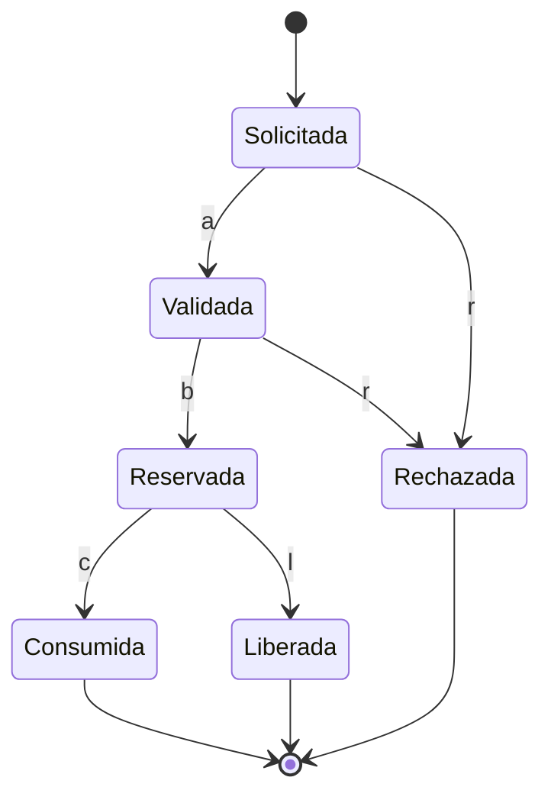
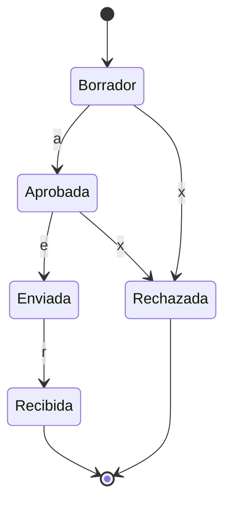

# Fase A · Tres autómatas finitos deterministas (JFLAP)

## Procedencia y supuestos

Se sigue el enunciado **Deber2_Teoria_Computacion_LOGISTPULSE_USFQ.docx**, Fase A (págs. 3–4): tres procesos (pedido, reserva y compra), definición formal `(Q, Σ, q₀, F, δ)`, **dos secuencias válidas y dos inválidas para cada uno**, con justificación. Se conserva la secuencia obligatoria del pedido **Borrador → Confirmado → Reservado → Preparación → Empacado → Despachado → Entregado**, la de reserva **Solicitada → Validada → Reservada → Consumida**, y el ejemplo inválido **Rechazada → Enviada**. Los eventos de cancelación, rechazo y liberación, así como algunas etiquetas intermedias del modelo de compras, son **propuestas de diseño del equipo** para completar la especificación (el enunciado invita a completar y justificar los eventos); no se presentan como restricciones adicionales impuestas literalmente por el profesor.

**Convención JFLAP:** los archivos `.jff` son autómatas finitos deterministas (DFA). Cada transición consume **una sola letra**, porque las pruebas de *Input → Multiple Run* procesan símbolos. El nombre completo del evento se documenta en las tablas. **No escribas las palabras** `confirmar`, `reservar`, etc. en la entrada de JFLAP: introduce cadenas como `abcdef`. **Transición ausente = rechazo**, porque el DFA es parcial. Ninguna flecha de aceptación implica por sí sola que exista stock real; los guardas operativos (stock disponible, autorización, etc.) deben controlarse por lógica de aplicación, no por este DFA abstracto.

## A1 · Pedido

**Definición formal:**
- Q = {Borrador, Confirmado, Reservado, Preparacion, Empacado, Despachado, Entregado, Cancelado}.
- Σ = {a, b, c, d, e, f, x}.
- q₀ = Borrador.
- F = {Entregado, Cancelado}. El primero representa cumplimiento; el segundo, cierre por cancelación. Ser final significa **proceso cerrado**, no necesariamente entrega exitosa.
- δ = tabla de abajo; cualquier par no especificado rechaza la secuencia.

| Estado | Evento | Significado | Estado siguiente |
|---|---|---|---|
| Borrador | `a` | confirmar pedido | Confirmado |
| Confirmado | `b` | reservar inventario | Reservado |
| Reservado | `c` | iniciar preparación | Preparacion |
| Preparacion | `d` | empacar | Empacado |
| Empacado | `e` | despachar | Despachado |
| Despachado | `f` | entregar | Entregado |
| Borrador | `x` | cancelar antes de reservar | Cancelado |
| Confirmado | `x` | cancelar antes de reservar | Cancelado |



## A2 · Reserva

**Definición formal:**
- Q = {Solicitada, Validada, Reservada, Consumida, Liberada, Rechazada}.
- Σ = {a, b, c, l, r}.
- q₀ = Solicitada.
- F = {Consumida, Liberada, Rechazada}; los tres resultados cierran el proceso por vías distintas.
- δ = tabla de abajo; cualquier otro par no está permitido.

| Estado | Evento | Significado | Estado siguiente |
|---|---|---|---|
| Solicitada | `a` | validar disponibilidad | Validada |
| Validada | `b` | reservar stock | Reservada |
| Reservada | `c` | consumir reserva | Consumida |
| Reservada | `l` | liberar reserva | Liberada |
| Solicitada | `r` | rechazar solicitud | Rechazada |
| Validada | `r` | rechazar solicitud | Rechazada |



## A3 · Orden de compra

**Definición formal:**
- Q = {Borrador, Aprobada, Enviada, Recibida, Rechazada}.
- Σ = {a, e, r, x}.
- q₀ = Borrador.
- F = {Recibida, Rechazada}. Una orden rechazada se cierra y no puede enviarse.
- δ = tabla de abajo. La aprobación precede obligatoriamente al envío.

| Estado | Evento | Significado | Estado siguiente |
|---|---|---|---|
| Borrador | `a` | aprobar orden | Aprobada |
| Aprobada | `e` | enviar orden al proveedor | Enviada |
| Enviada | `r` | registrar recepción | Recibida |
| Borrador | `x` | rechazar orden | Rechazada |
| Aprobada | `x` | rechazar orden | Rechazada |



## Pruebas mínimas y resultados esperados

| Proceso | Entrada para JFLAP | Resultado esperado | Explicación |
|---|---|---|---|
| Pedido (Fulfillment) | `abcdef` | **Aceptar** | Pedido confirmado, reservado, preparado, empacado, despachado y entregado |
| Pedido (Fulfillment) | `ax` | **Aceptar** | Cancelación de pedido confirmado antes de reserva |
| Pedido (Fulfillment) | `e` | **Rechazar** | Borrador → Despachado: no permitido |
| Pedido (Fulfillment) | `ae` | **Rechazar** | Confirmado → Despachado: faltan reserva, preparación y empaque |
| Reserva de inventario | `abc` | **Aceptar** | Solicitada → Validada → Reservada → Consumida |
| Reserva de inventario | `abl` | **Aceptar** | Solicitada → Validada → Reservada → Liberada |
| Reserva de inventario | `c` | **Rechazar** | No consumir una reserva que no fue validada |
| Reserva de inventario | `ac` | **Rechazar** | No consumir desde Validada sin reservar |
| Orden de compra (Reposición) | `aer` | **Aceptar** | Borrador → Aprobada → Enviada → Recibida |
| Orden de compra (Reposición) | `ax` | **Aceptar** | Borrador → Aprobada → Rechazada |
| Orden de compra (Reposición) | `xe` | **Rechazar** | Rechazada → Enviada no es posible |
| Orden de compra (Reposición) | `e` | **Rechazar** | No enviar desde Borrador sin aprobación |

**Estados finales:** no basta con detenerse en un estado intermedio; la secuencia es aceptada solo si consume todas las letras y termina en F. Por ejemplo, en pedido `a` llega a Confirmado pero **se rechaza** como ejecución completa porque Confirmado no es final; `abcdef` sí llega a Entregado. La cadena `x` permite cerrar el pedido desde Borrador por cancelación, aunque los dos ejemplos válidos mínimos de la tabla son `abcdef` y `ax`.

## Procedimiento para reproducir en JFLAP

1. Descargar o clonar el repositorio; abrir JFLAP (autómatas finitos).
2. En JFLAP, ir a **File → Open** y seleccionar `jflap/pedido.jff` (repetir con `reserva.jff` y `compra.jff`).
3. Comprobar visualmente los estados, la flecha inicial y los círculos dobles de aceptación; identificar la leyenda de símbolos en esta documentación.
4. Usar **Input → Multiple Run** (o equivalente según versión). Introducir las cuatro cadenas indicadas para cada archivo, una por fila. Ejecutar y guardar capturas de las doce salidas.
5. Para una secuencia inválida, puede fallar una transición (por ejemplo `e` en Borrador) o terminar en estado no final. La transición inexistente representa una operación prohibida, no un fallo del programa.

## Evidencia automatizada y limitación

El archivo `tests/test_automatas.py` verifica estructura XML JFLAP, determinismo, estado inicial, estados finales y el resultado de las **12 secuencias**, sin depender de una instalación de JFLAP. Ejecutar:

```bash
python -m unittest discover -s tests -v
```

**Pendiente para la entrega:** capturas reales de ejecución en la interfaz JFLAP. El test Python **no sustituye** esa evidencia visual exigida por la rúbrica. El proyecto propone los eventos adicionales y debe documentarlos como decisiones de modelado.
