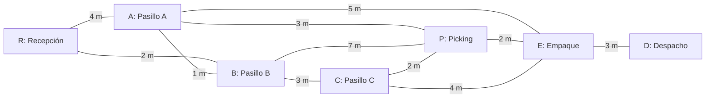

# Fase B · Grafo ponderado de planta y rutas AMR

**Fuente:** Figura 5 y texto de la página 5 del enunciado `Deber2_Teoria_Computacion_LOGISTPULSE_USFQ.docx`. Los pesos son **metros dentro de una planta de ejemplo**, no coordenadas reales.

## 1. Definición formal

G=(V,E,w), **no dirigido**, ponderado, con pesos no negativos.
- V = {R, A, B, C, P, E, D}.
- R=Recepción; A=Pasillo A; B=Pasillo B; C=Pasillo C; P=Picking; E=Empaque; D=Despacho.
- w representa distancia en metros.
- AMR origen R, destino D.
- **Zonas bloqueadas iniciales: ninguna**. Los bloqueos en pruebas son supuestos hipotéticos para validación, no datos de la figura.
- **Supuesto:** los pasillos son bidireccionales. Si aparecen restricciones de un solo sentido, debe utilizarse un grafo dirigido y adaptar el modelo.

## 2. Aristas y pesos exactos de la figura

| Arista | Peso | Arista | Peso |
|---|---:|---|---:|
| R—A | 4 | R—B | 2 |
| A—B | 1 | A—P | 3 |
| A—E | 5 | B—P | 7 |
| B—C | 3 | C—P | 2 |
| P—E | 2 | C—E | 4 |
| E—D | 3 | | |

**7 vértices y 11 aristas.** Datos estructurados en `docs/edges_planta.csv`.



## 3. Algoritmo y resultado

**Problema:** hallar ruta de menor distancia entre R y D, usando pasillos disponibles.

**Algoritmo:** Dijkstra con lista de adyacencia, cola de prioridad y diccionario de predecesores; es **exacto** para pesos no negativos.

**Ruta resaltada en el enunciado:**
- R → B → A → P → E → D
- 2 + 1 + 3 + 2 + 3 = **11 m**.

**Otra ruta óptima:** R → B → A → E → D = 2 + 1 + 5 + 3 = **11 m**.

**Por qué pueden diferir las rutas:** Dijkstra conserva el primer predecesor que mejora estrictamente la distancia; si dos rutas empatan, ambas son óptimas. El código devuelve la segunda; la ruta destacada en el enunciado también es válida y mínima.

| Nodo procesado (costo acumulado) | Mejoras |
|---|---|
| R (0) | A=4, B=2 |
| B (2) | A=3, C=5, P=9 |
| A (3) | P=6, E=8 |
| C (5) | Sin mejoras |
| P (6) | E=8, empate |
| E (8) | D=11 |
| D (11) | Llegada |

## 4. Pseudocódigo

```text
DIJKSTRA_AMR(grafo, origen, destino, bloqueadas)
    validar vertices, pesos y zonas bloqueadas
    dist[v] = infinito para cada vertice
    dist[origen] = 0
    prev = vacio; cola = [(0, origen)]
    mientras cola tenga elementos:
        (d, u) = extraer minimo
        si d != dist[u]: continuar
        si u == destino: terminar
        para cada (v,peso) vecino de u:
            si v esta bloqueado: continuar
            si d + peso < dist[v]:
                dist[v] = d + peso
                prev[v] = u
                insertar en cola (dist[v],v)
    si dist[destino] es infinito: devolver SIN_RUTA
    reconstruir ruta mediante prev desde destino hasta origen
    devolver (ruta, dist[destino])
```

## 5. Precondiciones, postcondición y terminación

- **Precondiciones:** grafo finito, aristas bidireccionales simétricas (en este modelo), pesos finitos no negativos, origen/destino registrados y no bloqueados.
- **Postcondición:** retorna una secuencia de adyacencias de costo mínimo entre R y D, o `None` si no existe conexión. Datos inválidos generan `ValueError`.
- **Terminación:** la cola de prioridad procesa un número finito de mejoras; Dijkstra finaliza con distancias mínimas de los nodos alcanzables, y los predecesores permiten reconstruir el camino.

## 6. Complejidad

- V = número de vértices, E = número de aristas.
- Tiempo: **O((V+E) log V)** con lista de adyacencia y heap binario; incluye la reconstrucción O(V). En variante lazy heap, otra cota es O((V+E)log(V+E)), equivalente para grafos simples.
- Espacio auxiliar: **O(V+E)**, por heap, distancias, bloqueos y predecesores. El grafo también ocupa O(V+E).
- **Exacto**, no heurístico ni aproximado.

## 7. Código, pruebas y resultados observados

Código: `src/planta_amr.py`. Pruebas: `tests/test_planta_amr.py`.

```bash
python -m src.planta_amr
python -m unittest discover -s tests -v
```

**Salida observada en la ejecución local de referencia:**

```text
Ruta mínima R→D: R → B → A → E → D = 11 m
Ruta resaltada en Figura 5: R → B → A → P → E → D = 11 m
Con P bloqueado: (['R', 'B', 'A', 'E', 'D'], 11)
Con A y P bloqueados: (['R', 'B', 'C', 'E', 'D'], 12)
```

Las **12 pruebas unitarias locales** terminaron satisfactoriamente, incluyendo: estructura exacta, ruta normal, ruta resaltada, empate, origen=destino, P bloqueado, destino inalcanzable, origen inexistente, destino bloqueado, peso negativo, arista asimétrica y duplicación.

## 8. Cumplimiento de rúbrica

Incluye grafo ponderado, origen/destino del AMR, tipo de aristas, pesos, bloqueos como hipótesis de prueba, ruta mínima de 11 m, precondiciones y terminación, Dijkstra con predecesores, Big-O temporal y espacial, implementación reproducible y pruebas normales, extremas e inválidas. Corresponde a la **Fase B: grafo y rutas** (criterio de 1,5 puntos), sujeto a revisión docente.
